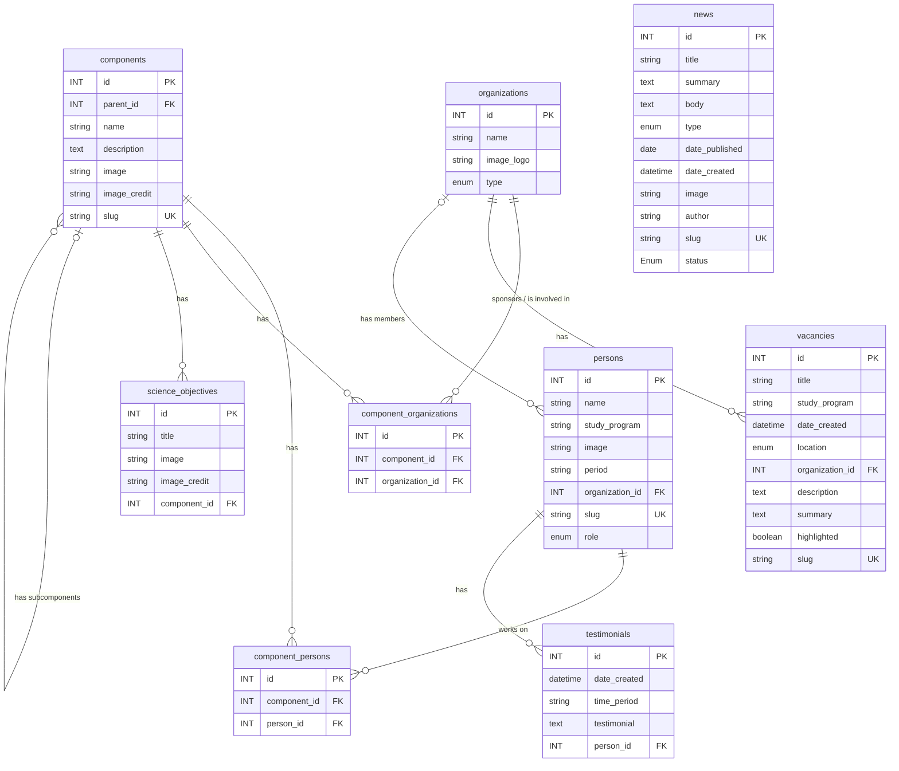

# Datamodel

## Legend

### Keys

| Notation | Meaning |
|---|---|
| `PK` | Primary key |
| `FK` | Foreign key, references the primary key of another entity |
| `UK` | Unique key, the value must be unique |

### Relations

| Symbol | Meaning |
|---|---|
| `\|\|` | Exactly one |
| `\|o` | Zero or one |
| `o{` | Zero or more |

### Junction tables

`component_persons` and `component_organizations` are junction tables.

