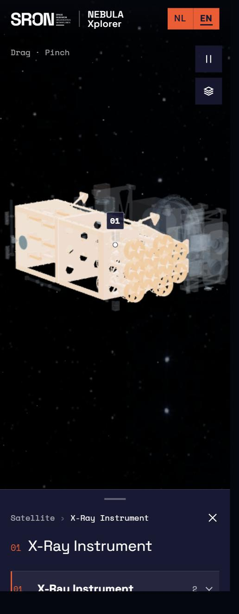
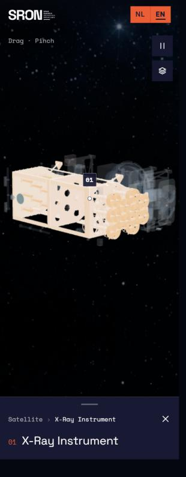
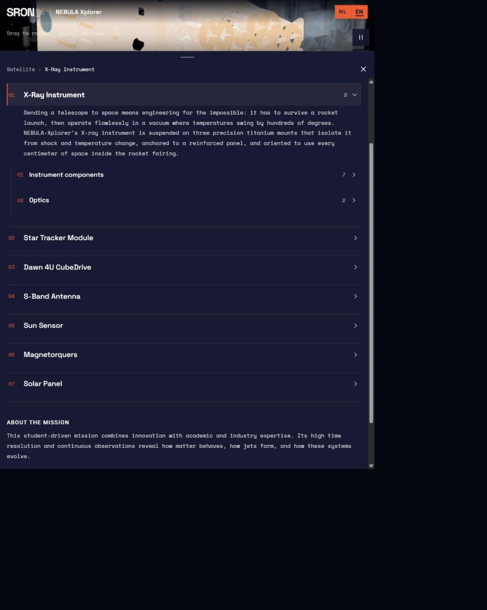
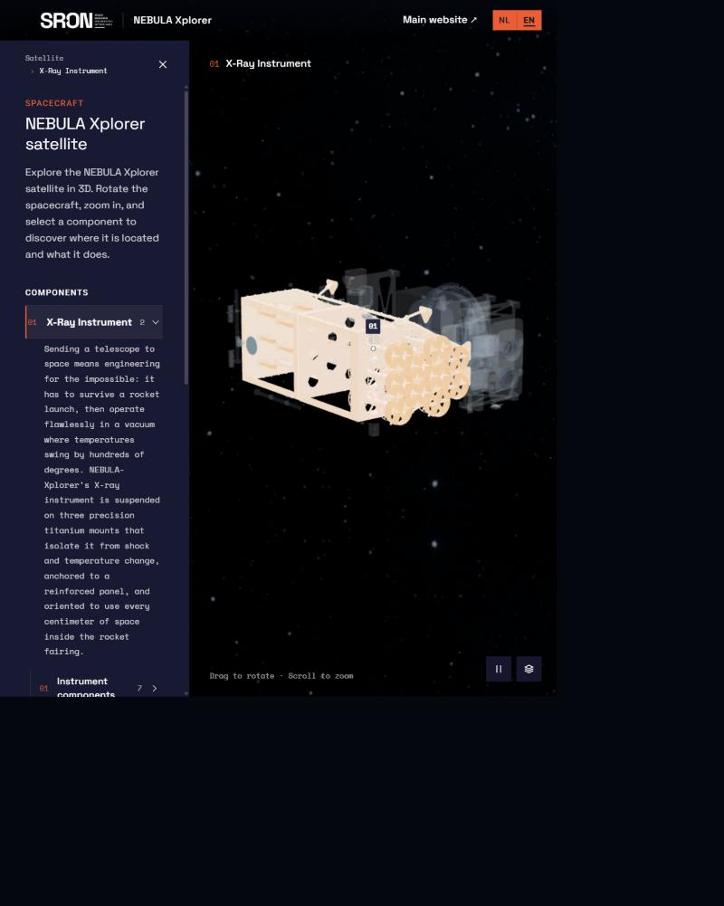
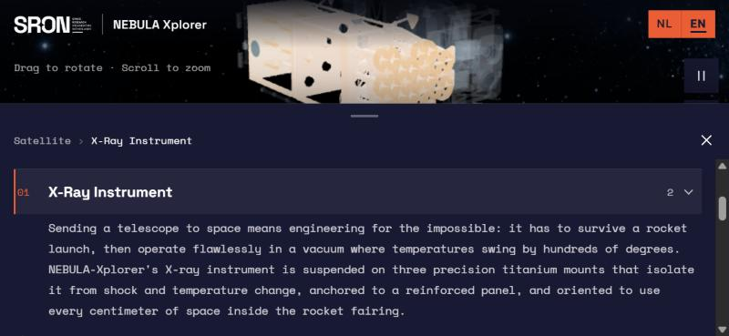
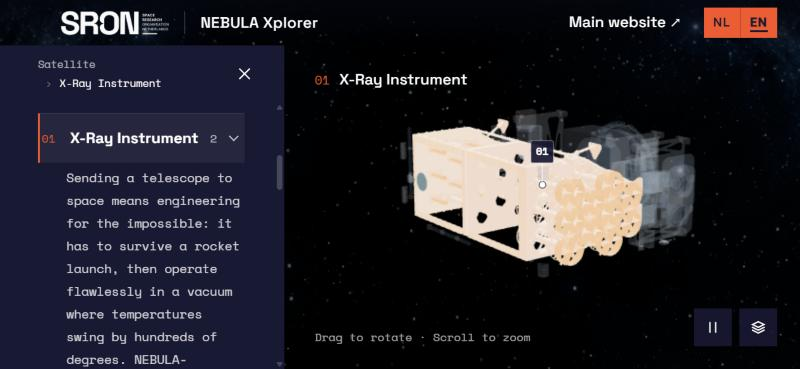
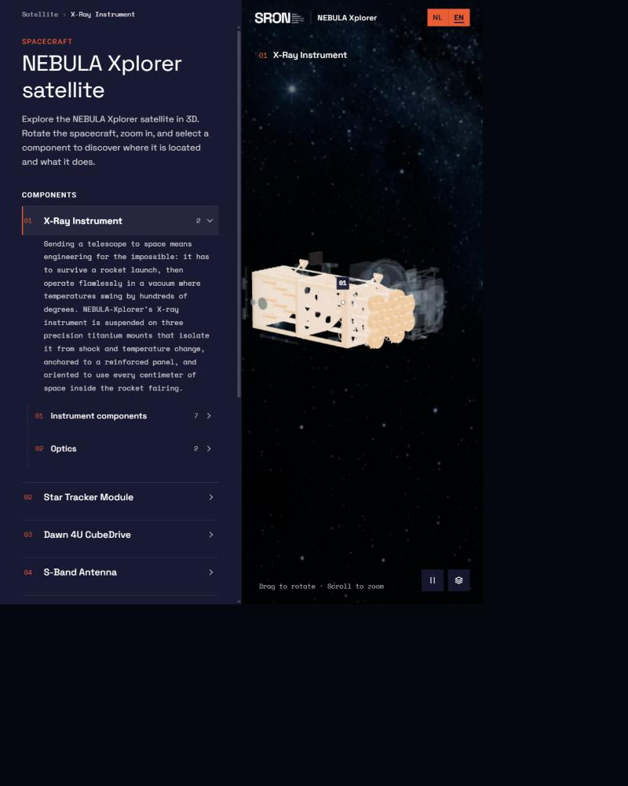
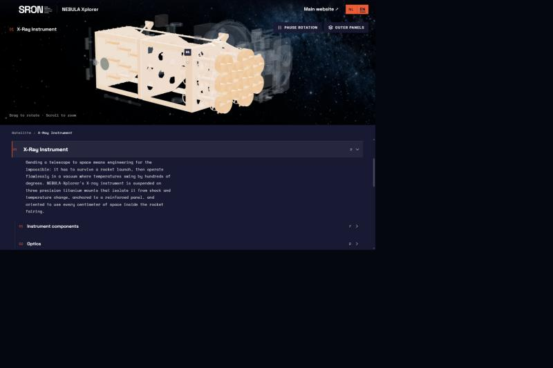
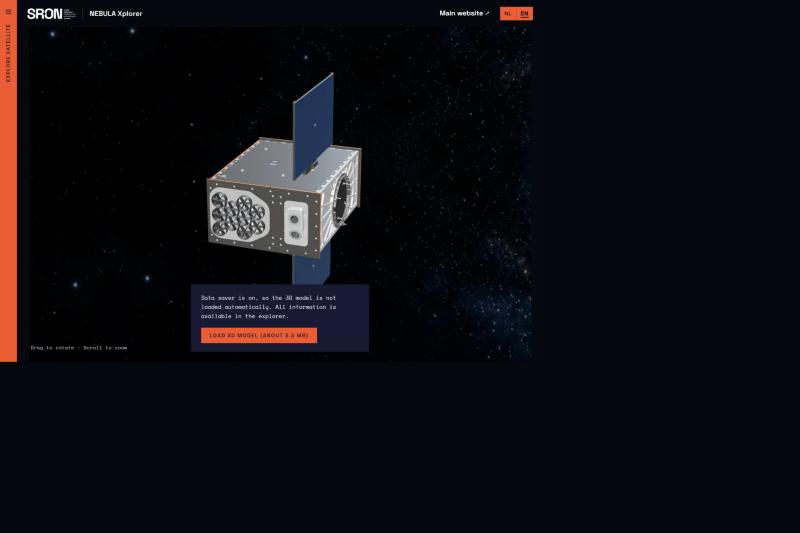

# Responsive design in a component-driven world: NEBULA Xplorer

Order of layers, unchanged: **HTML first → responsive CSS → JavaScript explorer → Three.js viewer.**
The approved UX stays the same: fullscreen 3D viewer, a continuous expandable explorer, only the panel or sheet scrolls while JavaScript is active, and SRON house style.

Testing was done in the in-app Chromium browser with viewport emulation, plus code-level checks (`npm run verify:satellite`). Where emulation was not possible, that is stated explicitly below.

---

## 1. Foldables

### What was tested

| Device / posture | Viewport | Before | After |
|---|---|---|---|
| Galaxy Z Fold, folded (cover screen) | 344 × 882 |  |  |
| Galaxy Z Fold, unfolded | 882 × 1104 |  |  |
| Phone in landscape | 844 × 390 |  |  |
| Dual screen, book posture (simulated) | 882 × 1104 | – |  |
| ASUS Zenbook Fold, laptop posture (simulated) | 1280 × 853 | – |  |

### What broke

- **Unfolded Z Fold (882 px wide)** was treated as a big phone. The bottom sheet stretched across 882 px and covered about 90 % of the screen. Text lines grew to roughly 95 characters, and the 3D model shrank to a 120 px strip. On the real device the fold runs vertically through the middle of both the text and the model.
- **Landscape phones** got the same bottom sheet over 70 % of a 390 px tall screen. The "Outer panels" control ended up hidden behind the sheet.
- **Folded cover screen**: the peek state showed the selected item twice (in the bar and in the list behind it), and the header product name wrapped.
- **Camera framing** did not follow layout changes, so after unfolding the model could sit behind the explorer.

### Design solution

- **Layout is decided by available space, not by "phone or desktop".** The bottom sheet is only used below 720 px wide. From 720 px the explorer is a side panel with `clamp(300px, 34vw, 420px)`. This covers unfolded foldables, tablets and landscape phones. Short landscape screens also get a compact 48 px header.
- **Dual screen (Viewport Segments API) as progressive enhancement:**
  - `@media (horizontal-viewport-segments: 2)`: the explorer is docked in the left segment and the 3D model in the right segment.
  - `@media (vertical-viewport-segments: 2)`, for example the Zenbook Fold in laptop posture: the 3D model sits in the top segment and the explorer in the bottom segment.
  - Sizes come from `env(viewport-segment-*)` with fallbacks. Nothing important crosses the fold: header content, item label, controls, hint and markers all stay inside the 3D segment, and markers are clipped to it.
  - In docked layouts both segments are always visible, so the open/close controls are hidden.
- **One source of truth for the layout mode.** CSS exposes `--explorer-mode` (`panel`, `sheet`, `docked-columns`, `docked-rows`). JavaScript reads it instead of duplicating breakpoints. The camera offset is measured from the visible viewer area, so the model is always centred in the part of the screen the visitor can actually see.
- The camera reframes the selection when the layout mode changes, for example when unfolding the device, unless the visitor has moved the camera themselves.

### Was the Viewport Segments API useful?

Yes, but only as an enhancement. It lets the hinge become a real division between "3D" and "explorer" instead of a line through the content. It is experimental, so:

- nothing depends on it; the space-based layout above is the fallback everywhere
- the dual-screen layouts were **simulated** here by switching the CSS layout mode, with the segment geometry coming from the `env()` fallbacks. A real hinge, or DevTools' foldable posture emulation, still needs to be tested on a device. See "Still to investigate".

---

## 2. User preferences

| Preference | What changes | Why |
|---|---|---|
| `prefers-reduced-motion: reduce` | No automatic rotation or cinematic orbit; camera flights become instant cuts; panel, sheet and expand animations become near-instant; X-ray animation does not play; star twinkle and nebula drift stop; smooth scrolling becomes instant. State changes stay clear through the selected bar, bold title, `aria-current` and `aria-expanded`. | Continuous or large motion can cause discomfort. No information is carried only by motion. |
| `prefers-reduced-transparency: reduce` | Header, viewer controls and markers use solid SRON navy instead of translucent navy; the panel drops its shadow. | The panel was already solid navy; this removes the remaining translucency over the 3D scene. |
| `prefers-contrast: more` | Body text goes to full white, muted text to 90 %, dividers to 48 % opacity; focus rings become 3 px; markers and controls get solid backgrounds and white outlines; the selected bar becomes 4 px wide. | Improves legibility on top of a busy 3D background. |
| `forced-colors: active` | System colours take over. The selected item gets a `Highlight` outline and an underlined title (not colour alone); controls, markers and the language switch get `ButtonText` borders; tree guide lines use `CanvasText`. | Box shadows disappear in forced colours, so state must survive through outlines, borders and text decoration. |
| `prefers-color-scheme` | **Not implemented as a light theme, on purpose.** | The product is a dark space scene with original CAD colours, and SRON's own site uses navy for this kind of content. A light UI over a dark 3D scene would lower contrast where the two meet and weaken the "SRON interface + immersive scientific scene" contrast. `color-scheme: dark` keeps form controls and scrollbars consistent. |
| `prefers-reduced-data: reduce` (and `navigator.connection.saveData`) | The 3D models (~5.5 MB) and the nebula background are **not** downloaded automatically. The viewer shows a 30 KB rendered still of the satellite and a "Load 3D model (about 5.5 MB)" button. The explorer works immediately. | The semantic content is the product; the 3D is an optional enhancement. `prefers-reduced-data` is still experimental, so the Save-Data signal, which ships in Chromium today, is checked as well. |

Evidence for reduced data: before the button is pressed only `satellite-overview.webp` and the logo load. After pressing it, `Satellite.viewer.glb` and the nebula texture load, and focus moves to "Explore satellite".

---

## 3. Container queries

Media queries are still used for **page layout** (sheet, panel or docked). **Component presentation** responds to the space the component actually gets.

| Component | Container | Breakpoints | What adapts |
|---|---|---|---|
| Explorer rows and component information | `.explorer-scroll` (`explorer`) | `< 340px`, `≥ 520px` | Compact: smaller title, narrower number column and indentation. Roomy: larger rows and titles, descriptions capped at about 60 characters per line. |
| Breadcrumb and current item (sheet bar) | `.explorer-bar` (`explorer-bar`) | `< 320px` | Smaller breadcrumb and current-item text. |
| Viewer controls | `.viewer-visible-area` (`viewer-hud`) | `< 640px` | Icon-only buttons; the label stays in the DOM, visually hidden, for screen readers. |
| Site header | `.site-header` (`site-header`) | `< 600px`, `< 360px` | Hides "Main website" (also in the explorer credits), then shrinks the logo and drops the divider while keeping the product name. |

**Why container queries are better here:**

- The explorer is 300–420 px as a side panel, 344–719 px as a sheet, about 441 px per segment on a dual-screen device and up to 760 px as a no-JS document. The viewport width says almost nothing about the width of a row.
- The viewer controls must fit the area *next to the open panel*, not the viewport. On an unfolded Fold, the viewport (882 px) suggested full text buttons, but only 582 px was visible and the hint collided with the controls. Making the visible viewer area the container fixed this without extra breakpoints.
- The same semantic markup is used in every layout; only CSS changes.

---

## 4. Progressive enhancement

- **Without JavaScript:** a normal scrolling document. The full nested hierarchy is expanded, the links and numbering work, descriptions are readable, and a rendered image of the satellite with alt text is shown. Nothing blocks the visitor; a small notice only explains that the interactive model needs JavaScript. The language switch is hidden because it cannot work without JavaScript.
- **Without WebGL:** the same document, plus a notice that the 3D model is not available on the device.
- **With JavaScript:** the explorer expands in place; the page itself does not scroll.
- **With Three.js:** the 3D viewer, markers and camera behaviour enhance the explorer.

## 5. Accessibility checks

Tested without using the canvas:

- keyboard: skip link → explorer → items
- visible orange focus ring on every focusable element
- `aria-expanded` and `aria-controls` on expandable items, `aria-current` on the selected item
- status announcements ("01, X-Ray Instrument, selected")
- Escape moves up one level and never traps focus
- collapsed parts are inert
- heading names such as "02, Baffles"
- the canvas is one labelled image and the markers are hidden from assistive technology

`npm run verify:satellite` checks the nesting, numbering, heading levels and status region.

## Still to investigate

- **Real dual-screen hardware** (or DevTools' foldable posture emulation): check the `env(viewport-segment-*)` values, the hinge gap on devices that have one, and posture changes at runtime.
- **`forced-colors`, `prefers-contrast` and `prefers-reduced-transparency`** could not be emulated in the test browser used here; they were reviewed in code. Check them in Chrome DevTools → Rendering → "Emulate CSS media feature", and in Windows High Contrast.
- **`prefers-reduced-motion`** is implemented and covered by `scripts/verify/camera-orbit.mjs` (disabled state). It still needs a visual check with the OS setting turned on.
- **`prefers-reduced-data`** only works behind a flag in Chromium; the Save-Data path is the one that works in practice. In development, `?reduced-data` simulates it (removed from production builds).
- Touch-specific testing on a physical foldable (sheet drag gesture across the fold).
